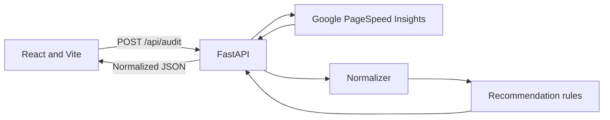

# WebPulse

WebPulse analyzes a public website with Google PageSpeed Insights and turns Lighthouse results into a normalized report with prioritized, evidence-backed recommendations.

## What it does

- Reports mobile Lighthouse scores for performance, SEO, accessibility, and best practices.
- Displays Core Web Vitals and supporting performance metrics.
- Generates actionable recommendations for 13 Lighthouse audit types.
- Shows affected resources, elements, and browser console errors where Lighthouse provides them.
- Removes URL credentials, query parameters, and fragments from evidence before returning it to the browser.
- Filters recommendations by category and priority.
- Returns clear errors for missing configuration, provider timeouts, rate limits, and provider failures.

## Architecture



The PageSpeed API key stays in the backend. The browser sends only the requested page URL to the WebPulse API. Recommendation rules share the signature `(audits, page_url)` and return the same contract: `id`, `category`, `priority`, `title`, `summary`, `evidence`, `where`, `whyItMatters`, `recommendedActions`, `example`, and `estimatedImpact`.

## Repository map

| Path | Purpose |
| --- | --- |
| `backend/app/main.py` | FastAPI app, CORS configuration, and route registration |
| `backend/app/api/routes/audit.py` | Audit endpoint and provider error translation |
| `backend/app/api/routes/health.py` | Lightweight API health endpoint |
| `backend/app/core/config.py` | Backend environment settings |
| `backend/app/schemas/audit.py` | Request validation and response models |
| `backend/app/services/pagespeed.py` | PageSpeed API client |
| `backend/app/services/normalizer.py` | Lighthouse response normalization and metric status calculations |
| `backend/app/services/recommendations.py` | Recommendation registry, rules, evidence handling, and URL sanitization |
| `backend/tests/` | Unit and API tests using Python's standard `unittest` framework |
| `frontend/src/pages/` | Home form and report page |
| `frontend/src/components/` | Score, metric, and recommendation presentation components |
| `frontend/src/hooks/useAudit.js` | Audit request state and user-facing errors |
| `frontend/src/services/auditApi.js` | Browser API client |
| `index.html` and `vite.config.js` | Vite entry point and frontend build configuration |

## Local development

### Requirements

- Python 3.11 or newer
- Node.js 20.19+ or 22.12+
- A Google PageSpeed Insights API key for live website analysis

### Backend

In PowerShell:

```powershell
cd backend
py -m venv .venv
.\.venv\Scripts\Activate.ps1
python -m pip install -r requirements.txt
Copy-Item .env.example .env
```

Set `PAGESPEED_API_KEY` in `backend/.env`, then run:

```powershell
uvicorn app.main:app --reload --port 8000
```

The health endpoint is `http://localhost:8000/api/health`; interactive API documentation is at `http://localhost:8000/docs`.

### Frontend

From the repository root, install dependencies and start Vite:

```powershell
npm install
Copy-Item .env.example .env
npm run dev
```

The Vite default URL is `http://localhost:5173`. `VITE_API_BASE_URL` may be set in the root `.env` if the API runs elsewhere. `FRONTEND_URL` in `backend/.env` controls the allowed CORS origin; multiple origins can be comma-separated.

## Deploy

The frontend is deployed to GitHub Pages, while the FastAPI service must be hosted separately. The root `render.yaml` configures the API for Render.

1. In Render, create a Blueprint from this repository and provide `PAGESPEED_API_KEY` when prompted. The blueprint provisions the FastAPI service as `webpulse-audit-api` so it does not reuse the existing `webpulse-api` hostname, which currently serves a different application. Wait for the service to deploy.
2. Verify the API at `https://webpulse-audit-api.onrender.com/api/health`.
3. The Pages workflow builds with `https://webpulse-audit-api.onrender.com` by default, matching the service name in `render.yaml`. If the Render service has a different public hostname, set the Actions variable `VITE_API_BASE_URL` to that HTTPS origin (no `/api` suffix); a repository variable overrides the default.
4. Run the **Deploy to GitHub Pages** workflow from the Actions tab so Vite rebuilds with the API URL.

The backend's `FRONTEND_URL` is set to `https://dogradsourabh.github.io` for CORS. This is the Pages origin; the `/webpulse/` repository path is not part of an origin. If the Pages site uses a different owner or custom domain, update that value in `render.yaml` before deploying. Keep `PAGESPEED_API_KEY` only in Render's backend environment, never in a GitHub Actions variable or frontend build.

## Tests and quality checks

With the backend virtual environment active:

```powershell
cd backend
python -m unittest discover -s tests -v
```

From the repository root:

```powershell
npm run lint
npm run build
npm run test:backend
```

The tests cover the recommendation interface and contract, rule thresholds, edge cases, URL and console evidence sanitization, normalization, input validation, and API behavior with a mocked PageSpeed provider. They do not require a live Google API request.

For `npm run test:backend`, activate the backend virtual environment first so the API dependencies are available to Python.

## Engineering decisions

- **FastAPI and Pydantic** provide typed request/response validation and a small asynchronous API layer.
- **PageSpeed stays server-side** so the API key is not included in the frontend bundle.
- **Normalized responses** keep the React report independent of the provider's raw Lighthouse response shape.
- **One recommendation interface** lets the engine run rules without special-casing individual functions.
- **Evidence is capped and sanitized** before reaching the client to keep reports manageable and avoid exposing URL credentials or query tokens.
- **Public target validation** rejects local/private IP targets and credential-bearing URLs.
- **Docker, CI/CD, hosting, reverse proxy/TLS, and production monitoring** are the next DevOps stage and are intentionally not part of this application-development milestone.

## Current limits

- PageSpeed results can vary between runs and require a valid Google API key and reachable Google service.
- Recommendations cover the audit types listed in `backend/app/services/recommendations.py`; no recommendation does not mean a site is free from every possible issue.
- Report state currently lives in React Router navigation state and is not persisted across a browser refresh.
